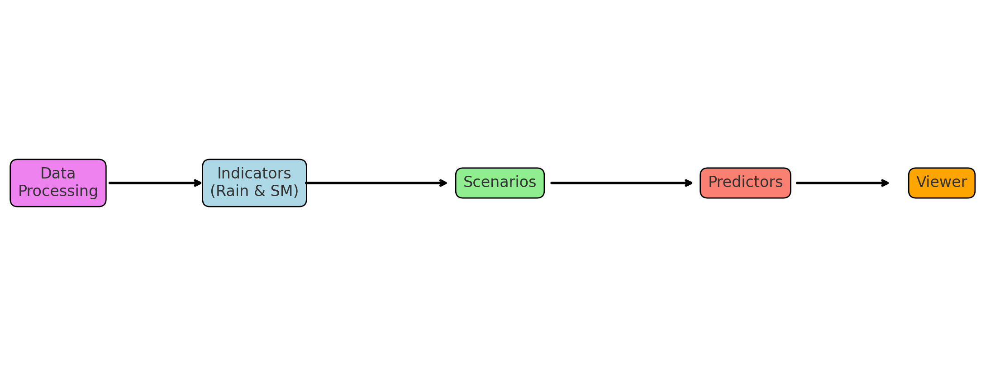

# SLIPER workflows

SLIPER prepares rainfall and soil moisture grids, computes indicators for alert areas, and joins them with observed soil slips to build scenario tables. The predictor application uses scenarios and training datasets to estimate soil-slip occurrence. The time-series viewer plots the outputs of observed and forecast runs.

## Run modes

| Mode | Inputs and outputs | Configuration suffix |
| --- | --- | --- |
| Observed real-time | Updates datasets and products as observations become available. | `obs_realtime` |
| Forecast real-time | Selects a model run, synchronizes forecast inputs and the preceding observed data, then generates forecast products and plots. | `frc_realtime` |
| Observed dataset build | Processes historical observations and builds indicator, scenario, and predictor datasets over configured periods. | `obs_db` |
| Historical or research runs | Reprocesses past periods using the available stage-specific configurations. | `history` or `research` |

The JSON templates and shell scripts are under `sliper/tools/binaries/`. Use the templates that match your deployment and data formats.

| Directory | Responsibility |
| --- | --- |
| `system/run/` | Select a forecast cycle and write the run metadata. |
| `system/data/` | Synchronize observed and forecast rainfall and soil moisture inputs. |
| `execution/` | Run the data, indicator, scenario, and predictor applications. |
| `analysis/` | Generate observed and forecast time-series plots. |
| `report/` | Read execution metadata and generate a status report and HTML dashboard. |
| `system/machine/` | Maintain datasets and workspace directories. |

See the [run selection guide](docs_tools_runner.md), [dataset synchronization guide](docs_tools_organizer.md), and [reporting guide](docs_app_report.md) for entry points and settings.
